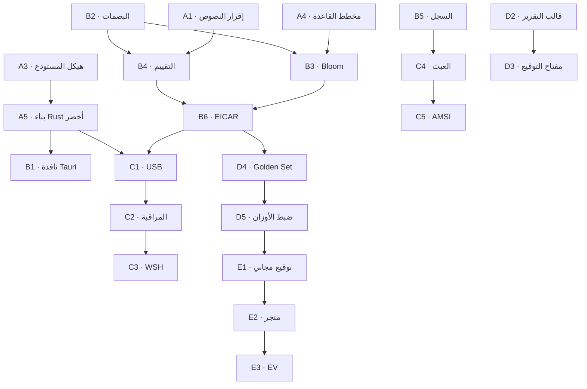

# خطة الإنجاز — مرتّبة بحسب ما يفتح ما بعده

> **الغرض:** هذا الملف يحلّ محلّ تسلسل «المراحل» في §13 من الموجّه. التسلسل هناك كان **زمنيًا** (أسابيع 1–18)، وهذا **اعتمادي**: كل خطوة مكتوبة لأن **شيئًا آخر يتوقف عليها**.
> **القاعدة:** لا خطوة بلا سبب وجودها. وإن لم يكن للخطوة تابع يتوقف عليها، فهي ليست خطوة — بل رفاهية.
> **المرجع:** `docs/odina-agent-prompt-v17.md` §13 · §17 · §36.4 · `docs/spec/*`

---

## 0. كيف تُقرأ هذه الخطة

| العمود | المعنى |
|--------|--------|
| **الخطوة** | عمل واحد يمكن إنجازه والتحقق منه |
| **لماذا الآن** | ما يتوقف عليها إن تأخّرت |
| **يعتمد على** | ما يجب أن يكون موجودًا قبلها |
| **البوابة** | كيف نعرف أنها انتهت فعلًا (قابلة للقياس) |
| **من** | **وكيل** (أستطيع إنجازه) · **مالك المشروع** (قرار أو جهاز) · **ناطق أصلي** |
| **المرونة** | ما يمكن تأجيله أو تقليصه بلا كسر التسلسل |

**وثلاث قواعد تحكم الترتيب كله:**

1. **لا شيء يُبنى قبل مراجعته** (§36.4). لهذا تأتي القرارات قبل الكود.
2. **أي عائق خارجي (ناطق أصلي، جهاز ويندوز، مفتاح توقيع) يُؤجَّل بلا تعطيل المسار.** لكل عائق بديل مكتوب.
3. **كل خطوة تُنتج شيئًا يُرى.** لا خطوة تنتهي بـ«جاهز داخليًا».

---

## 1. الحالة الآن — تقييم صادق

[فحص 2026-11-18](reviews/review-2026-11-18.md): راجع مالك المشروع معاينة **الرئيسية والتنبيهات (R4)** ووجدها مناسبة. طُبّقت ملاحظته على القوائم: اسم الوجهة فقط، والتفسير في تلميح. لا يعني ذلك اعتماد بقية الشاشات أو الترجمات، ولا إغلاق G1.

| # | ما أُنجز | الحالة | ما يبقى فيه |
|---|---------|--------|--------------|
| 1 | المستودع + الهيكل | ✅ | — |
| 2 | الترخيص (AGPL · MIT · OFL · NOTICE) | ✅ | بطاقة GitHub تظهر `none` — جمالي فقط |
| 3 | الموجّه v17 (كل القرارات) | ✅ | يُحدَّث مع كل قرار جديد |
| 4 | **الوثائق الست** في `docs/spec/` | ✅ | — |
| 5 | **CI: بوابات المستودع + بناء Rust** | ✅ | البناء أخضر على ويندوز وLinux · الناقص: Golden Set |
| 6 | **الترجمة: 10 لغات × 461 مفتاحًا** | 🟡 | **لم يراجعها ناطق أصلي** — وهذا لا يمنع الكود |
| 7 | **الشعار + الهوية (R3)** | ✅ | — |
| 8 | **نصوص الشاشات (R4)** | 🟡 | روجعت الرئيسية والتنبيهات؛ تبقى بقية الشاشات |
| 9 | سكربت نشر الموقع | ✅ | يحتاج `firebase login` عندك |
| 10 | المعاينة `ui-preview.html` | ✅ | ليست التطبيق — لا سلوك حقيقيًا |
| 11 | **الكود** | 🟡 | `odina-core` + `odina-cli`: **`odina scan <مجلد>`** يصنّف ملفات حقيقية · `check` يكتب القياس محليًا · لا واجهة ولا Tauri بعد (B1) |
| 12 | **Golden Set** | ❌ | يبدأ بـEICAR (منجز) ثم عيّنات تعليمية معزولة (§6.1) |
| 13 | **قالب التقرير + مفتاح التوقيع** | 🟡 | كاتب التقرير موجود؛ يبقى قرار مكان المفتاح · أما **توقيع EXE** فسياسيته كاملة في `docs/code-signing.md` |

**الخلاصة:** التخطيط والحوكمة انتهيا فعليًا، **وأول سطر كود صار حقيقة مقيسة**. **كل ما تبقّى هو تنفيذ.** وأكبر خطر الآن ليس الخطأ في التصميم — بل **البقاء في التصميم**.

---

## 2. المسارات الخمسة — ولماذا هذا الترتيب

```
A. قرارات لا تحتاج أحدًا   ← تفتح كل شيء، ولا تنتظر شيئًا
B. نواة قابلة للتشغيل       ← تُنتج شيئًا يُرى في أول أسبوع
C. ما يحتاج جهازًا          ← يُؤجَّل بلا تعطيل (B تعمل على Linux)
D. ما يحتاج عيّناتك         ← يُؤجَّل بلا تعطيل (يعمل على EICAR أولًا)
E. ما يحتاج نقودًا/توقيعًا  ← آخر شيء، وبعد 1,000 مستخدم
```

**وهذا هو جوهر المرونة:** B لا تنتظر C ولا D ولا E. ومن يعطّل مسارًا، يبقى المسار الآخر مفتوحًا.

---

## 3. المسار A — القرارات المعلّقة (أول 48 ساعة)

هذه **لا تنتظر أحدًا سوانا**، وكلها تعطّل ما بعدها.

| # | الخطوة | لماذا الآن | يعتمد على | البوابة | من | المرونة |
|---|--------|------------|-----------|---------|-----|---------|
| A1 | **إقرار R4** — نصوص الشاشات | كل نص في الكود يأتي منها؛ الإقرار الآن يمنع إعادة العمل | — | إقرار النصوص المتبقية | مالك المشروع | الرئيسية والتنبيهات روجعتا بالفعل |
| A2 | **إقرار R5** — الوثائق الست | كل سطر كود يُقاس عليها | — | كلمة واحدة | مالك المشروع | مؤجّل بلا أثر تقني — الكود يعمل بها كمرجع |
| A3 | **بنية المستودع للكود** — `src-tauri/` · `src/` · `crates/` | كل شيء يُبنى داخلها | — | الشجرة موجودة وتُبنى فارغة | وكيل | — |
| A3✅ | **الحالة (2026-11-15):** `crates/odina-core/` قائمة وتُبنى · `src-tauri/` مؤجل إلى B1 بقرار معلن | — | — | `docs/rust-workspace.md` | — | — |
| A4 | **تصميم قاعدة البيانات** (مخطط SQLite كاملًا) | كل شيء يقرأ منها؛ تغييرها لاحقًا مكلف | A2 | ملف SQL قابل للتنفيذ | وكيل | يمكن البدء بجدول واحد |
| A5 | **حزمة `Rust` الأساسية تُبنى في CI** | تُثبت أن البناء ممكن قبل كتابة 5,000 سطر | A3 | `cargo build` أخضر على Linux | وكيل | — |
| A5✅ | **الحالة (2026-11-15):** `.github/workflows/rust.yml` — **ويندوز نجح بالكامل** (clippy · build · test · doc)، وLinux سقط في `fmt` مرة واحدة ثم أُصلح. `Cargo.lock` مولَّد ومُلتزَم، والبناء كله بـ`--locked` | — | — | `docs/rust-workspace.md` §5–§6 | — | — |
| A6✅ | **D45 — قرار الاستثناء الجراحي** (§4.8 · Q11): قاعدة واحدة تُرخّى، والباقي لا يتحرك؛ المؤقت بلا استجواب، والدائم مرئي؛ A6 إرخاء فقط؛ الجدار 1 وحماية العبث لا يُستثنيان | كان انقلاب مخاطر: إطفاء الكل أسهل من إرخاء قاعدة — فيولّد الالتفاف الذي يريد منعه | — | نص ملزم + D45 في سجل القرارات | مالك المشروع | أُنجز 2026-11-18 |

**بوابة الخروج من A:** `cargo build` أخضر + مخطط قاعدة البيانات + قراراك A1/A2.

---

## 4. المسار B — النواة القابلة للتشغيل (الأسبوعان القادمان)

**الهدف المعلن:** في نهاية B، يوجد **برنامج يعمل ويفحص ملفًا حقيقيًا ويقول رأيه**. لا واجهة جميلة، لا USB، لا درايفر — بل **نواة صادقة**.

| # | الخطوة | لماذا الآن | يعتمد على | البوابة | من | المرونة |
|---|--------|------------|-----------|---------|-----|---------|
| B1 | **هيكل Tauri + نافذة واحدة** تعرض «أنت محمي» | أول شيء يُشغَّل ويُرى؛ يُثبت أن Tauri يعمل | A3, A5 | نافذة تُفتح على Linux | وكيل | يمكن استخدام معاينة HTML مؤقتًا |
| B2 | **محرك البصمات**: SHA-256 + قراءة رأس/ذيل 4KB | أساس كل شيء؛ بلا بصمة لا تقييم | A4 | يبصم 10,000 ملف في دقيقة | وكيل | — |
| B3 | **Bloom filter** للقاعدة | يمنع قراءة القرص لكل ملف؛ سرّ الخفة | B2 | 3 مليون بصمة في < 5 MB · FP < 0.1% | وكيل | يمكن البدء بـ500 ألف |
| B4 | **نموذج التقييم** (10 مؤشرات + سقوف + Veto) من `scoring-spec` | يحوّل الأرقام إلى قرار | B2 | 100 عيّنة معروفة → التصنيف الصحيح | وكيل | المؤشرات 8 (TLSH) و10 يمكن تأجيلهما |
| B5 | **سجل كل شيء** (SQLite + كتابة متسلسلة) | بلا سجل لا قرار ولا تصحيح | A4 | 1000 حدث/ث بلا فقد | وكيل | — |
| B6 | **EICAR + 20 عيّنة آمنة** كاختبار أول | يُثبت أن الكشف يعمل **بلا عيّناتك** | B3, B4 | EICAR يُكتشف · 20 سليمة تمرّ | وكيل | **هذا بديل مؤقت عن Golden Set** |
| B7 | **الاختبارات الآلية** (وحدة + تكامل) | كل ما بعد B يُبنى على صحته | B2–B6 | تغطية ≥ 70% للمحرك | وكيل | — |
| B8 | **نسخة الفحص + التقارير المدمجة** (§34) — `odina check` خلف ميزة `instrument`، و`odina-report/v1` بستة عشر حقلًا، و13 بوابة §34.2 | القياس وحده يحوّل الأوزان من فرضية إلى قياس؛ والأهم: **بنية التقرير يجب أن تسبق أول بيانات** | B4, D2 | ملف قياس واحد من جهاز حقيقي · بوابة `public` خضراء | وكيل | متوسط CPU وذروته مفتاحان: 3 من 14 قيمة قابلة للقياس حاليًا، والباقي غير مقيس بسبب معلن |
| B9 | **CPU أثناء الفحص** — 27.99% من نواة واحدة في القياس الأول | فشلت البوابة؛ لا تُقارَن النتيجة بنسبة الجهاز كله | B8 | اختبار لوحدة الحساب، ثم تشغيل قابل للمقارنة على نفس الجهاز والمجلد مقابل حدّ < 3% | وكيل + قياس على ويندوز | لا نغيّر الحد ولا نضيف خيوطًا قبل تحديد كلفة القراءة والبصمات |
| B10✅ | **وحدة `policy` في `odina-core`** — `Rule` × `Mode` × `Duration` × `Target` → استثناء أو رفض معلَّل | يمكن بناؤها واختبارها **اليوم بلا ويندوز**: نقية، بلا ساعة، بلا نظام | A6 | ١٣ اختبارًا خضراء: **العزل**، الانتهاء في اللحظة، الدائم المرئي، رفض A6، **مؤكد لا يُرخّى** | وكيل | أُنجز 2026-11-18 — `crates/odina-core/src/policy.rs` |
| B11✅ | **سياسة الأنشطة التسعة واحتواء الإصابة (D46)** — منع 3 تلقائيًا، و4 يُنصح بمنعها، و2 اختياريان | منع مؤقت مستقل عن اختيار المستخدم | B10 | اختبارات `proactive` ومعاينة `site`: لا استعادة قبل نجاح الإصلاح لآخر مهمة، ولا تشغيل عند الإيقاف الصريح | وكيل | منطق قرار قابل للاختبار، لا إنفاذ ويندوز بعد |
| B12✅ | **D47: مسار المعالجة وقاعدة الإصلاح المستقلة** | إنقاذ المضيف قبل العزل | B11 | وصفات تدريبية مطابقة بالبصمة، تحقق من الملف والحادثة، مسار عزل احتياطي، حزمة ويندوز بحدّ 100 MB واختبار المعاينة | وكيل | [المواصفة ونطاق التنفيذ](spec/repair-component-v1.md) |

**المسار المقيم:** اجتازت [تقارير المالك W2 على HDD وSSD في Linux](perf/resident-w2.md) بوابات الخمول والاستجابة والحمل المحدد؛ ليس ذلك قبول Windows/NTFS. **D48 — [قائمة المتصفح](browser-integration.md):** اختيار واحد، استعلام محلي بلا قراءة جديدة، فحص ملف مشتبه بإذن مستقل. نُفِّذ المضيف والإضافة والتسجيل؛ قبول القوائم الفعلية على أجهزة المستخدم وتفعيل العزل الآمن ليسا مكتملين.

**ترتيب الفروع التالية (لا دمج إلا بطلب صريح):** بعد قائمة المتصفح، System Tray ← System Toasts ← Activity Log ← W3 (إيقاف وتصريف وإعادة تشغيل وتعليق/استئناف وإشراف الجلسة) ← W4 (الملفات الكبيرة والكتابة البطيئة والدفعات والفقد وNTFS الفعلي). شاشتا حالة الخدمة والمعالجة ليستا جزءًا من فرع القائمة.

**بوابة الخروج من B:** أمر واحد يفحص مجلدًا ويطبع: عدد الملفات · المُشتبه بها · EICAR كـ«مؤكد». **وأنا أستطيع إنجاز B كاملًا هنا على Linux.** — ويُضاف إليها **B10**: استثناء قاعدة، وتحقّق أن الثانية لم تتغيّر.

> **ما قِيس فعلًا (2026-11-18):** 26,939 ملفًا · 10.03 GB · 9.75 دقيقة · 4.69 MB قبل بدء فحص CLI · **27.99% من نواة واحدة (فشل)** · صفر تقارير. الملف في `docs/perf/baseline/`. ثلاث نتائج: لا شيء كُشف (المسار B ناقص، لا حساسية)، CPU عيب يُسجَّل في B9، وEICAR لم يُرَ بعد فبوابة B لم تُثبت تنفيذًا.

**إضافة (B8):** والباب يُفتح أكثر حين يُنتج الأمر نفسه ملف قياس محليًا يمكن إرساله. ملف القياس الأول محفوظ في `docs/perf/baseline/`. [مراجعة G1/B6](reviews/g1-proof-2026-11-19.md): على لينكس صدّر `check` تقرير تنبيه واحدًا للمتجه المعياري من ملف، ولم ينبّه `scan` أو `check` على أيٍّ من الملفات السليمة العشرين. بقي فحص ملف مُنزَّل من المصدر الرسمي واعتماد مالك المشروع.

> **لماذا B قبل الواجهة الكاملة؟** لأن الواجهة بلا نواة = **شاشة جميلة تكذب**. والنواة بلا واجهة = **برنامج صادق**. ومن يبنى العكس يُضطر لإعادة كتابة النواة حين تظهر متطلبات الواجهة.

---

## 5. المسار C — ما يحتاج ويندوز (بالتوازي، لا يعطّل B)

| # | الخطوة | لماذا الآن | يعتمد على | البوابة | من | المرونة |
|---|--------|------------|-----------|---------|-----|---------|
| C1 | **USB Hot-Trigger** (استيقاظ + P0/P1) | جوهر التخصص | B2–B5 | استجابة < 50ms · P0 < 3s | وكيل (كود) · مالك المشروع (اختبار) | يُكتب على Linux ويُختبر عندك |
| C2 | **مراقبة الملفات** (ReadDirectoryChangesW) | الحماية الفعلية | C1 | حدث لكل كتابة على مسار محمي | وكيل · مالك المشروع | — |
| C3 | **WSH Restricted** + سياسة المصادر + **واجهة الاستثناءات** (D45 §4.8): تبديل لكل قاعدة، ربط السجل، الشارة المرئية | يُغلق أكبر باب تنفيذ **بلا أن يصير عائق عمل** | C2 · B10 | `.vbs` مقيّد افتراضيًا · استثناء WSH يعمل ويعود · PowerShell لم يتغيّر | وكيل · مالك المشروع | الكود يُكتب ضد واجهة `policy` النقية |
| C4 | **حماية العبث** (خدمة + إعادة تشغيل) | بدونه يمكن إطفاء Odina | B5 | قتل الخدمة → تعود | وكيل · مالك المشروع | — |
| C5 | **AMSI provider** (`regsvr32`) | يرى السكربتات قبل تنفيذها | C4 | سكربت مشبوه يُوقف قبل التنفيذ | وكيل · مالك المشروع | يمكن تأجيله إلى ما بعد أول إصدار |
| C6 | **WDAC deny-hash** | يمنع التشغيل على Home | C4 | ملف محظور لا يعمل | وكيل · مالك المشروع | مؤجّل |
| C7 | **ربط D46 وD47 بخدمة ويندوز** | قرار النواة ليس اعتراضًا لنشاط فعلي | B12 · C2–C5 | التقاط كل نشاط في نطاقه قبل تنفيذه، استمرار المهام غير المحسومة بعد إعادة التشغيل، ورفع المنع فقط بعد إصلاح مُتحقّق منه | وكيل + اختبار ويندوز معزول | يتطلب مخزن عزل وسجل تراجع دائمين، تحققًا بعد الاستبدال، ووصفات عائلات إنتاجية مختبرة |

**المرونة الحاسمة:** إذا لم يتوفر جهاز ويندوز، **C لا يوقف أي شيء**. الكود يُكتب ويُختبر وحداتيًا على Linux، والتحقق النهائي عندك. **ولا نُدّعي أنه يعمل قبل أن نراه يعمل.**

---

## 6. المسار D — ما يحتاج بيانات (يبدأ صغيرًا ويكبر)

| # | الخطوة | لماذا الآن | يعتمد على | البوابة | من | المرونة |
|---|--------|------------|-----------|---------|-----|---------|
| D1 | **20 عيّنة آمنة + EICAR** (بديل مؤقت) | يُثبت المحرك الآن | B6 | ✅ يبدأ فورًا | وكيل | — |
| D2 | **قالب التقرير + JSON Schema** | يُثبت شكل البيانات قبل جمعها | A2 | تقرير صالح ضد المخطط | وكيل | 🟡 **الكاتب والمدقق جاهزان** (`crates/odina-report`)؛ الناقص: تقرير حقيقي واحد من جهازك |
| D3 | **قرار مكان مفتاح التوقيع** | مفتاح ضائع = بيانات مزيّفة | A2 | ورقة قرار: أين يُحفظ، من يملكه | مالك المشروع | يمكن تأجيل التوقيع إلى ما بعد 100 مستخدم |
| D4 | **Golden Set 5,500** | يُصحّح الأوزان بالقياس لا بالرأي | عيّناتك | recall ≥ 99.5% · FPR ≤ 0.1% | مالك المشروع + وكيل | **يبدأ بـ200 عيّنة وينمو** |
| D5 | **ضبط الأوزان من النتائج** | يحوّل التقييم من فرضية إلى قياس | D4 | FPR < 1% على 500 سليمة | وكيل | — |

### 6.1 من أين تأتي العيّنات — والقواعد الأربع

| المصدر | ماذا يعطي | آمن للبدء؟ |
|--------|-----------|-------------|
| **EICAR** | سلسلة 68 بايتًا معيارية، بلا أي خطر | ✅ **نبدأ به اليوم** — في `crates/odina-core/tests/eicar.rs` |
| **theZoo** (GitHub) | أرشيف عيّنات تعليمي قديم، منظّم ومُصنَّف | ⚠️ داخل جهاز معزول فقط |
| **MalwareBazaar** (abuse.ch) | عيّنات حديثة ببيانات وصفية وبصمات | ⚠️ داخل جهاز معزول، بعد تسجيل بحثي |
| **MalShare** | أرشيف مشابه، بحدّ تنزيل يومي | ⚠️ نفسه |

**القواعد الأربع — لا تُفاوَض:**

1. **لا تُنسخ عيّنة إلى هذا المستودع أبدًا**، ولا إلى Git History، ولا إلى Release. تُحمَّل داخل جهاز افتراضي معزول (بلا شبكة، بلقطة قبل الفحص).
2. **لا يُشغَّل أي ملف عيّنة** — يُقرأ كبايتات فقط: بصمة، رأس، ذيل، حجم. تشغيل عيّنة ليس اختبارًا، بل حادثة.
3. **الأرشيف للحصول على بصمات، لا للقائمة** — ما يُحفظ في المستودع هو **بصمة SHA-256 وسجل وصفي**، لا الملف.
4. **ما يُنشر من نتائج يذكر البصمة فقط** — ولا يُرفق الملف، ولا رابط تنزيل مباشر.

**ولهذا يبدأ D1 بـEICAR وحده:** لأنه يثبت الأنبوب كاملًا (بصمة ← تقييم ← قرار) بلا أي خطر قانوني أو تقني. والعيّنات الحقيقية تدخل حين يكون العزل جاهزًا، لا قبله.

**المرونة:** D4 **لا يمنع الإطلاق المبكر**. يُشحن بأوزان `scoring-spec` كفرضية معلنة، ثم تُصحّح. والصدق في أن الأوزان فرضية أفضل من ادعاء دقة غير مقيسة.

---

## 7. المسار E — ما يحتاج مالًا أو توقيعًا (آخر شيء، بقصد)

| # | الخطوة | الشرط | التكلفة |
|---|--------|-------|---------|
| E1 | **SignPath / شهادة مجانية للمشاريع المفتوحة** — السياسة والشروط في `docs/code-signing.md`، والسياسة منشورة في `signing.html` | 🟡 السياسة والاختبار الذاتي جاهزان · التقديم ينتظر أول EXE (R1–R7) | **0** |
| E2 | **متجر Microsoft (MSIX)** — Microsoft يُعيد التوقيع، فلا شهادة خاصة بنا | 100 مستخدم | **0** (حساب مجاني للأفراد والشركات) |
| E3 | **EV + درايفر kernel** | 1,000 مستخدم + G4 | **$250–500/سنة** — **مؤجّل بقرارك** |
| E4 | **تبرّعات** | ≥95% كشف + صفر إنذار كاذب في 500 ملف سليم | **0 تكلفة لبدئه** |

**القاعدة الحاكمة:** **لا خطوة في E تمنع الإطلاق.** التوقيع المجاني يكفي للبداية، والـEV ينتظر أن يطلبها المستخدمون بأفعالهم لا بكلامنا.

---

## 8. التسلسل الحاسم — ما لا يجوز أن يسبق ما



**أربعة مسارات حرجة لا تُخترق:**

1. **بلا A3/A5 لا كود.** (لا مستودع، لا بناء.)
2. **بلا B2 لا تقييم، وبلا B3 لا خفة، وبلا B4 لا قرار.**
3. **بلا B6 لا شيء يُثبت أن المحرك يعمل** — ولو كان كل شيء آخر سليمًا.
4. **بلا A1 (نص) لا واجهة** — لأن الواجهة **نص، لا رسوم**.

---

## 9. الخريطة الزمنية المرنة — لا أسابيع، بل بوابات

| المرحلة | تُنجز حين | ما يمكن تأجيله | ما لا يمكن |
|---------|-----------|-----------------|------------|
| **A · الأساس** | ~2–3 أيام | A2 | A1 · A3 · A4 · A5 |
| **B · النواة** | ~2–3 أسابيع | B3 (500 ألف بدل 3 مليون) · مؤشر 8 و10 | B2 · B4 · B6 |
| **C · ويندوز** | بالتوازي مع B | C5 · C6 | C1 · C4 |
| **D · البيانات** | يبدأ فورًا وينمو | D4 (يبدأ بـ200) · D3 (تأجيل التوقيع) | D1 · D2 |
| **E · التوزيع** | بعد أول إصدار | E3 | E1 |

**ولا يوجد «أسبوع 12» مقدَّس.** يوجد **بوابة** تُفتح أو لا تُفتح. ومن يُنجز أسرع يتقدّم؛ ومن يتأخر لا يُسقط أحدًا معه.

---

## 10. المرونة — أربع قواعد تحمي الخطة من نفسها

| # | القاعدة | كيف تُطبَّق |
|---|---------|--------------|
| **1** | **لكل عائق بديل مكتوب** | ناطق أصلي غائب → اللغة تُعلَّق (7 مشحونة تكفي) · جهاز ويندوز غائب → C يُؤجَّل وB تعمل · عيّنات غائبة → EICAR و20 سليمة · مفتاح غائب → التقرير بلا توقيع مؤقتًا |
| **2** | **لا خطوة تُنتج شيئًا لا يُرى** | كل بوابة تُنتج ملفًا أو أمرًا أو شاشة |
| **3** | **التأجيل قرار لا فشل** | كل سطر «مؤجّل» يجب أن يقول **ما الذي يعطّل تأجيله** — وإن لم يُعطّل شيئًا، فالتأجيل صحيح |
| **4** | **الخطة تُعاد كتابتها بعد كل بوابة** | هذا الملف **ليس عقدًا** — بل لقطة. تُحدَّث عند كل إنجاز، ولا يُعتبر تحديثها فشلًا |

---

## 11. ما بعد أول إصدار (بقصد: لا تفصيل)

| المرحلة | الشرط |
|---------|-------|
| **M1 · اليمن** | أول EXE موقّع + 100 مستخدم |
| **M2 · العالم العربي** | M1 مستقر + تقارير كافية |
| **M3 · العالم** | M2 + 1,000 مستخدم + مراجعة ناطق أصلي لكل لغة |

**ولا تُباع هذه المراحل قبل أوانها.** الخطة التي تعد بعشر لغات وتُسلّم واحدة أسوأ من خطة تعد بواحدة وتُسلّمها.

---

## 12. البوابات الأربع الحاسمة

| البوابة | المعنى | الحالة |
|---------|--------|--------|
| **G0** | `cargo build` أخضر + مخطط القاعدة + CI يبنيه | 🔄 **البناء والاختبارات خضراء على ويندوز وLinux** — الناقص: مخطط القاعدة (A4) |
| **G1** | **أمر واحد يفحص مجلدًا ويصنّف ملفًا حقيقيًا** (مع EICAR) | قيد الإثبات: [نتيجة التشغيل وما بقي للاعتماد](reviews/g1-proof-2026-11-19.md) |
| **G2** | USB: استيقاظ < 50ms · P0 < 3s · على ويندوز حقيقي | ⬜ |
| **G3** | أول EXE موقّع، ومعه R1–R7 مكتملة | ⬜ |

**وG1 هو الحدّ الفاصل الحقيقي:** قبله مشروع ورق، وبعده **برنامج**.

---

**الخلاصة:** المسار الآن **A3 → A5 → B2 → B4 → B6**، وكل ما عداه ينتظر أو يتوازى. **هذا الملف يُقرأ مع `docs/spec/` لا بدلًا منها.**
