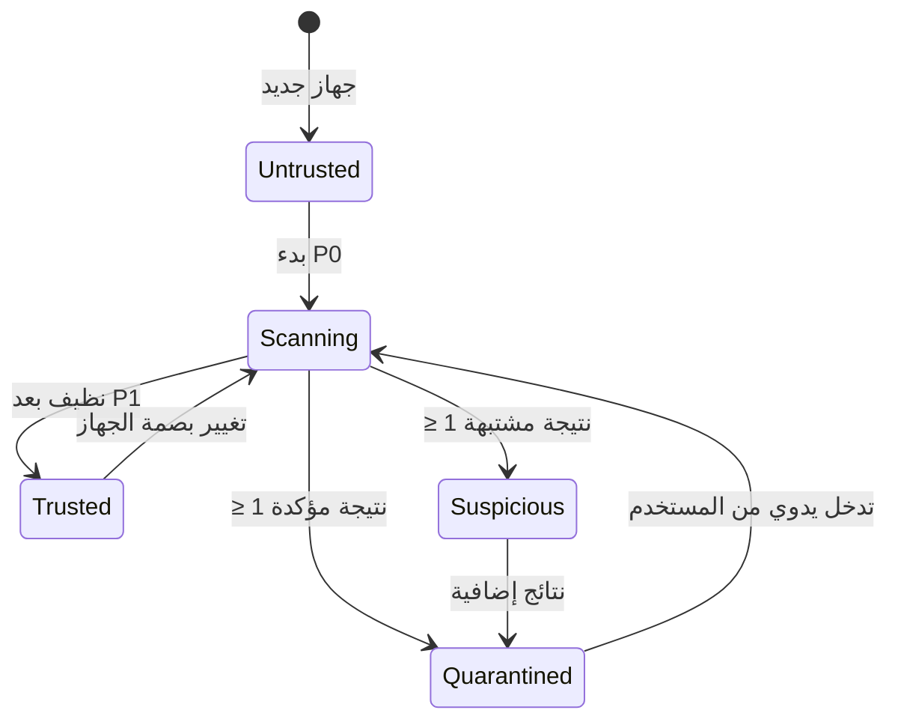

# Odina — وثيقة أمن USB v1 (USB Security Spec)

> **الحالة:** ✅ معتمدة — 2026-11-16
> **المرجع:** `docs/odina-agent-prompt-v18.md` §6 · §3.8
> **السبب:** USB هو **جوهر تخصص Odina** — وهو ناقل العدوى الأول في اليمن والمنطقة العربية، حيث تنتقل الملفات بين الأجهزة يدويًا أكثر مما تُنزَّل.

---

## 1. لماذا USB هو الجبهة الأولى

| الحقيقة | الأثر |
|---------|-------|
| الانتقال اليدوي للملفات شائع جدًا | فلاشة واحدة تكفي لنقل عدوى إلى شبكة كاملة |
| كثير من الأجهزة لا تتصل بالإنترنت أصلًا | الحماية السحابية **لا قيمة لها** هناك |
| `autorun.inf` ما زال يعمل في كثير من البيئات | التشغيل التلقائي بلا نقرة واحدة |
| الملفات تُسمَّى بالعربية | أنظمة الأمن الأجنبية تُسيء التعامل معها |
| الفلاشة تمرّ بين عدة أجهزة |  **جهاز واحد مصاب = مسح للجميع** |

**ولهذا:** أي مكافح مبني على «تنزيل الحماية» فقط **لا يحمي مستخدمنا الفعلي**. الحماية عند **إدخال الفلاشة**، قبل أي شيء.

---

## 2. الاستيقاظ (Hot-Trigger)

هذا عقد للمنتج على Windows لا وصف للمراقب الحالي. **وصول وسيط** يوقظ تقييم جدار البيانات؛ **إدخال عنصر خطر** يضيف سببًا مؤقتًا لجدار السلوك وفق §3.1 من الموجّه. لا نساوي كل قرص جديد بعنصر مصاب، ولا نكتب تفضيل «الدائم» بسبب حدث USB. عند إخراجه تنتهي مهمة الوسيط بعد تصريفها؛ حادثة نشطة على الجهاز لا تُغلق بذلك. الإيقاف الصريح النافذ مُحتَرم.

| البند | القيمة |
|-------|--------|
| المشغّل | `WM_DEVICECHANGE` + `DBT_DEVICEARRIVAL` |
| **زمن الاستجابة المستهدف** | **< 50 ms** من لحظة الإدخال إلى عرض الشريط |
| **بدء الفحص** | **< 300 ms** — أي قبل أن يفتح النظام نافذة الملفات عادة |
| استهلاك CPU عند الخمول | **0%** — لا استقصاء دوري، الاستيقاظ حدثي فقط |
| ما لا نفعله | **لا** قراءة كامل الفلاشة قبل الفحص. **لا** فتحها للتشغيل |

**قاعدة نقدية:** لا نُجمّد النظام. إن كان الفحص سيستغرق وقتًا، يعمل في الخلفية، ويُعطى المستخدم **تقدّمًا** لا شاشة تجميد.

---

## 3. حالة الثقة بالجهاز (Device Trust State)



| الحالة | السلوك | منع التنفيذ؟ |
|--------|--------|---------------|
| 🟥 **Untrusted** (جديد) | فحص كامل P0→P1 | **نعم** حتى انتهاء P1 |
| 🟨 **Scanning** | فحص جارٍ | **نعم** — مؤقتًا فقط |
| 🟩 **Trusted** | فحص delta لتغيّر الملفات فقط | **لا** |
| 🟧 **Suspicious** | مراقبة مشددة خلال خطر الوسيط، لا رصد دائم للجهاز | **لا** — إلا الملفات المشتبهة (زرّان: السماح · المنع) |
| ⬛ **Quarantined** | منع كامل + خيار «أنا أثق بهذا الجهاز» | **نعم** |

`Quarantined` في هذا الرسم **حالة ثقة بالجهاز** تمنع التنفيذ منه؛ لا تعني نقل كل ملفاته إلى صندوق العزل أو تجاوز التحقق من إصلاح ملف مصاب.

### 3.1 بصمة الجهاز

```
VendorID + ProductID + VolumeSerial + Capacity
```

**وليس:** اسم الجهاز · مسار التركيب · اسم المستخدم · **اللغة** · **المنطقة**.

**لماذا يدخل VolumeSerial في البصمة؟** لأنه **يتغيّر عند الفرمتة** — وهذا مقصود: الفلاشة المفرَّمتة قد تكون نظفت فعلًا، أو أعيد استخدامها. **لا نثق بجهاز بحكم اسمه**، بل بحكم محتواه الحالي.

**حدّ الاعتراف:** يمكن استنساخ بصمة جهاز (نظريًا) لتضليل النظام. والأثر محدود: الحالة تُعيد الفحص عند أول تغيير ملف. **الهدف تقليل العمل، لا الحماية الجنائية.**

---

## 4. الفحص المتدرّج — P0 إلى P3

| الأولوية | المحتوى | **المدة المستهدفة** | ملاحظة |
|----------|---------|----------------------|--------|
| **P0** | `.lnk` · `.exe` · `.scr` · `.bat` · `.vbs` · `.js` · `.cmd` · **`autorun.inf`** في **الجذر فقط** | **< 3 ثوانٍ** | الأولوية الأولى: هذا هو الهجوم النمطي |
| **P1** | كل التنفيذيات في كل المجلدات (حتى العمق 6) | < 15 ثانية | |
| **P2** | مستندات وأرشيفات (`.docx` · `.pdf` · `.zip` · `.rar`) | < 2 دقيقة | كشف الماكرو والصيغ الخبيثة |
| **P3** | بقية الملفات | خلفية، بلا حدّ زمني | خفض تلقائي عند حمل النظام > 70% |

### 4.1 قرار بعد P0 — إجباري

بعد P0 مباشرة، **يُعرض للمستخدم قراره** ولا يُترك بلا دعم:

| نتيجة P0 | الإجراء |
|----------|---------|
| نظيف | **الشريط يختفي بصمت** بعد 3 ثوانٍ — بلا إشعار «كل شيء بخير» (§2.1) |
| مشتبه | تنبيه بكلمة، **زرّان**: السماح · المنع |
| مؤكد | منع تشغيل الملف، ثم [المعالجة](repair-component-v1.md) وزر «متابعة المعالجة». لا يُنقل مضيف قابل للإنقاذ إلى العزل تلقائيًا |

**هذا هو جوهر التجربة:** المستخدم يُدخل الفلاشة، يرى 3 ثوانٍ من الفحص، ثم **إما صمت أو قرار**. لا انتظار، لا تساؤل، لا سؤال «ماذا تريد أن نفعل؟».

---

## 5. القواعد السلوكية الثماني — بتفصيل واجب

**حاجز قبول G2 (Q19 في الموجّه):** في القاعدة 1 أدناه يتعارض تعميم «غير موقّع = مؤكد» مع اختبار «ملف autorun سليم = لا تنبيه» لملف سليم غير موقّع. يُعرض على المالك مثالان آمنان قبل تنفيذ حكم بهذه الصيغة: ما الذي يستدعي منع التشغيل التلقائي، وما الذي يثبت إصابة الملف؟ هذا سؤال سياسة مفتوح، لا صلاحية للجدار لتغيير حكم G1 بالاسم.

| # | القاعدة | التفصيل | الاختبار |
|---|---------|---------|----------|
| **1** | **`autorun.inf` يُعامل كخبيث دائمًا** | لا تحليل، لا استثناء. أي `autorun.inf` غير موقّع = مؤكد | ملف autorun سليم = لا تنبيه |
| **2** | **الملفات المخفية تُقرأ ولا تُتجاهل** | سمات `hidden` + `system` تُرفع الحذر، **لا تُخفيه** | ملف مخفي بنفس اسم ملف نظام = يُكشف |
| **3** | **الامتداد الحقيقي يُفحص** | `document.pdf.exe` يُقرأ كـ`.exe`، ويُعرض **الاسم الكامل** لا `.pdf` | — |
| **4** | **لا تنفيذ حتى انتهاء P1** | المنع مؤقت وله حدّ زمني. **لا منع دائم** | — |
| **5** | **الملفات بالأسماء غير اللاتينية: حكم واحد** | عربية · صينية · روسية — **لا تُصنَّف أعلى لأنها غير إنجليزية، ولا تُتجاهل لأنها غير مقروءة** | مقارنة ثنائية: `setup.exe` مقابل `تثبيت.exe` بنفس البصمة = **نفس النتيجة** |
| **6** | **السجل بـ UTF-8 escaped** | يبقى قابلًا للقراءة في أي لغة واجهة | سجل يحتوي اسمًا عربيًا يُعرض صحيحًا |
| **7** | **الفلاشة الموجودة سابقًا تُفحص من جديد** | إدخال في يوم جديد = بداية جلسة جديدة | — |
| **8** | **`Device Trust` يُصفَّر عند أي تغيير ملف** | لا «ثقنا بها سابقًا» | إضافة ملف واحد → إعادة فحص delta |

### 5.1 القاعدة 5 هي الأهم — ولماذا

البرمجيات الخبيثة في منطقتنا تُسمَّى بالعربية عمدًا: لأنها تختبئ من أدوات تفحص الإنجليزية فقط، ولأن الضحية يثق بما يقرأه.

**لو أخطأنا هنا، نصبح نحن أداة الهجوم:** مكافح يرفع الحذر لمجرد أن الاسم عربي = ينبّه على ملفات سليمة لشركة يمنية، ويترك الملف الخبيث المسمّى `setup.exe` يمر.

**ولهذا القاعدة مطلقة: اللغة ليست إشارة (§3.8).** والفحص على **البصمة والبنية**، لا على الحروف.

---

## 6. واجهة تنبيه USB

```
┌────────────────────────────────────────────────┐
│  ⬛  USB_32GB                                   │
│                                                │
│  ▓▓▓▓▓▓░░░░░░░░  34%                          │
│  فحص سريع · 11 ملف  ·  0 تنبيه                 │
│                                                │
│                          [ عرض المتوقع: 4 ثوانٍ ]│
└────────────────────────────────────────────────┘
```

| القاعدة | التفصيل |
|---------|---------|
| **زرّان كحد أقصى** | وعندما لا يكون هناك قرار، **صفر أزرار** |
| **لا Modal** | الشريط في الزاوية، لا يحجب العمل |
| **تقدّم واحد فقط** | لا نسبة داخل نسبة، لا خطوتين |
| **مدة متوقعة عند الإمكان** | «4 ثوانٍ» أفضل من «جارٍ» |
| **لغة الاتجاه** | RTL: أسفل-يسار · LTR: أسفل-يمين |
| **الصمت عند النجاح** | النظيف يختفي — لا «تم！」 |

---

## 7. ميزانيات الموارد لـ USB

| البند | السقف | خفض تلقائي |
|-------|--------|------------|
| CPU | **≤ 5%** | عند حمل النظام > 70% → ≤ 2% |
| RAM إضافي | **≤ 30 MB** | يُحرَّر فور خروج الجهاز |
| القراءة من القرص | ≤ 30 MB/s | لا يُشبع الفلاشة (كثير من الفلاشات الرخيصة تتعطل) |
| مدة الفحص | P0 < 3s · P1 < 15s | في الخلفية بلا حدّ |

**ملاحظة ميدانية:** الفلاشات الرخيصة في أسواقنا تتعطّل عند القراءة المتوازية المكثّفة. **القراءة المتسلسلة أفضل من المتوازية هنا** — حتى لو كانت أبطأ على الورق.

---

## 8. ماذا لا نفعله — نفي صريح

| ❌ لا | لماذا |
|-------|-------|
| لا نُفرمت الفلاشة | قرار يفقده المستخدم، ولا نفعله أبدًا |
| لا نحذف الملفات | §8.2.2 — العزل قرار المستخدم |
| لا نقرأ كامل القرص لمجرد الإدخال | يبدأ الفرز بالأولويات؛ المطابقة الدقيقة لبصمة ملف تعني قراءة البايتات اللازمة لها، لا تشغيل الملف أو إرسال محتواه |
| لا نُوقف النظام | لا تجميد، لا شاشة زرقاء |
| لا نطلب صلاحيات إضافية | ما نحتاجه فقط |
| لا نُرسل قائمة ملفات الفلاشة | أسماء الملفات بيانات خاصة |
| لا نميّز على أساس اللغة | §3.8 |

---

## 9. حالات الاختبار الإلزامية (Golden USB Set)

| # | العيّنة | النتيجة المطلوبة |
|---|---------|-------------------|
| 1 | فلاشة نظيفة (2,000 ملف سليم) | صفر إنذار · صفر تنبيه |
| 2 | `autorun.inf` تقليدي | مؤكد فورًا، < 3s |
| 3 | `فاتورة.pdf.exe` | يُكشف كـ exe، الاسم كاملًا معروض |
| 4 | ملف مخفي باسم `System Volume Information` | يُكشف رغم التشابه |
| 5 | أسماء عربية بنفس البصمة كأسماء إنجليزية | **نفس الدرجة** |
| 6 | فلاشة مُعلَّمة Trusted يُضاف إليها ملف | إعادة فحص delta |
| 7 | فلاشة بحمل قراءة عالٍ | لا تعليق · لا تجميد · يخفض السرعة تلقائيًا |
| 8 | إدخال/إخراج 50 مرة متتالية | لا تسريب ذاكرة · لا بقاء عمليات |

---

## 10. بوابة القبول

- [ ] استجابة < 50 ms · بدء فحص < 300 ms
- [ ] صفر استهلاك CPU عند الخمول (لا polling)
- [ ] وسيط سليم مقابل عنصر خطر: فحص الوصول في الحالتين، وتفعيل السلوك المؤقت للخطر دون تعديل تفضيل الدائم
- [ ] القاعدة 5 مُختبرة بـ 100 زوج اسم عربي/إنجليزي — نتائج متطابقة
- [ ] حسم Q19 ثم اختبار حكم `autorun.inf` السليم مقابل الدليل المؤكد؛ لا إغلاق لهذه البوابة بالاسم وحده
- [ ] لا حذف ولا فرمتة في أي مسار كود
- [ ] Trust يُصفَّر عند أي تغيير ملف
- [ ] كل الثماني قواعد لها اختبار في Golden USB Set

---

**الخلاصة:** استيقاظ حدثي · P0 في 3 ثوانٍ · قرار من زرّين · لغة ليست إشارة · ولا حذف أبدًا.
